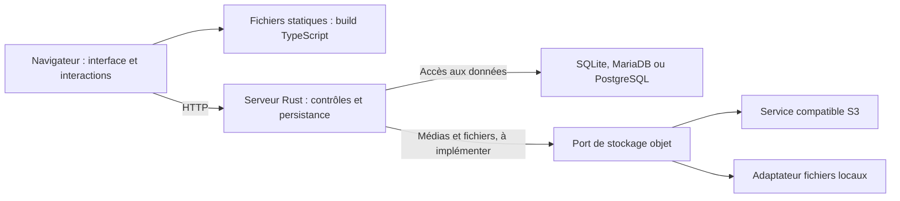

# Architecture proposée

## Organisation générale

Rust minimal et Preact constituent la base retenue, dans la continuité de
LiteCloud. Le squelette Rust utilise Axum/Tokio pour HTTP et l’exécution async.
Toute couche supplémentaire doit répondre à un besoin concret ; la justification
est consignée dans la [décision technique][stack].

En production, le client pourra être distribué comme des fichiers statiques sur
la même origine que l’API. Node.js sert aux outils de développement et de build
; aucun runtime Node n’est nécessaire à cette architecture proposée. Le mode de
distribution final reste à choisir.

## Décisions de conception

Le [modèle interne](domain-model.md) sépare étude, définition immuable, campagne
de collecte, réponse et droit de reprise. Les tables sont communes aux études ;
des blocs de données typés et versionnés limitent le nombre d’écritures et les
dépendances aux particularités JSON des bases.

L’adaptateur LimeSurvey conserve les éléments source et les correspondances
d’identifiants, en plus du modèle exécutable. Conservation, réexport, exécution
et continuité sont évalués séparément. Le
[transfert d’études en cours](study-migration.md) prépare une cible fermée et ne
l’ouvre qu’après validation d’un instantané cohérent.

La première implémentation porte sur l’adaptateur `.lss`. Le modèle de stockage
et le protocole complet restent à réaliser. Ces décisions s’appuient sur
l’[audit de la version 6.5.14](limesurvey-source-audit.md), sans attendre un
export de production.

Les médias, ressources et pièces jointes passeront par un port de stockage objet
indépendant du fournisseur. Un adaptateur compatible S3 permet le déploiement
sans volume disque persistant ; un adaptateur local représente les mêmes objets
par des fichiers. Les métadonnées et relations restent dans SQL. La
[décision 0002](decisions/0002-object-storage.md) fixe ce contrat. Ces
adaptateurs et la persistance métier sont différés : les prochains incréments
concernent les formulaires et leur saisie locale.

## Frontière de confiance

| Côté client             | Côté serveur                   |
| ----------------------- | ------------------------------ |
| Affichage et navigation | Droits d’accès                 |
| Validation immédiate    | Validation définitive          |
| Aperçu des conditions   | Conditions de validité         |
| Calculs d’interface     | Écritures, concurrence, quotas |
| Préparation des exports | Accès aux données exportées    |

Un résultat calculé par le navigateur n’est pas une preuve. Le serveur contrôle
les types, tailles, contraintes et transitions pertinentes au moment de
l’enregistrement. Les données privées, secrets et règles qui révéleraient des
informations protégées ne doivent pas être envoyés au client.

Les expressions LimeSurvey devront être traduites vers un langage borné et
testable. L’évaluation arbitraire de PHP ou de JavaScript importé est exclue. La
façon de partager la sémantique des règles entre Rust et TypeScript reste à
concevoir ; WASM n’est pas une dépendance imposée à ce stade.

## Modèle et dépendances

Le modèle de questionnaires est conçu indépendamment du format `.lss` et du
schéma interne de LimeSurvey. Un adaptateur traduira les fichiers vers ce modèle
et produira des diagnostics de compatibilité explicites. La représentation
source conservée ne remplacera jamais la validation du modèle exécutable.

Quand le métier sera introduit, séparer progressivement :

- les règles et types du domaine ;
- les adaptateurs d’import/export ;
- la couche HTTP et les autorisations ;
- les accès aux données et les migrations ;
- le client et son moteur d’interactions.

Créer ces modules au rythme des besoins. Le dépôt contient aujourd’hui
`crates/server`, `crates/migration`, `crates/limesurvey` et `web`. Le modèle de
lecture de l’adaptateur est propre au format source ; les identifiants natifs et
leur correspondance seront introduits avec la persistance métier.

## Sessions et progression

Le squelette n’implémente aucune session. Le modèle définit un checkpoint
durable et des droits de reprise séparés des participants. Les principes
d’implémentation sont les suivants :

- Distinguer la session d’un administrateur de la participation à un survey.
- Ne pas garder chaque participation dans une structure mémoire permanente.
- Enregistrer la progression utile en base et rendre la reprise possible après
  un redémarrage du serveur.
- Utiliser des identifiants opaques et vérifier les droits à chaque écriture.
- Rendre les sauvegardes répétées prévisibles, avec une stratégie explicite pour
  les doublons et les modifications concurrentes.
- Séparer les métadonnées d’accès des réponses lorsque l’anonymat l’exige.
- Prévoir expiration et nettoyage sans balayage coûteux à chaque requête.

Le mécanisme précis d’authentification, les cookies, l’anti-CSRF et la reprise
sur plusieurs appareils dépendent des parcours retenus. Le simple choix de
jetons signés ne règle pas à lui seul révocation, reprise ou confidentialité.

## Ressources et performance

Le squelette utilise un runtime Tokio sur un thread et un pool plafonné à quatre
connexions. Ce sont des valeurs de départ pour limiter les ressources, pas des
réglages validés pour une charge de production.

Les futurs imports et calculs coûteux devront être isolés des tâches HTTP et
bornés en concurrence. Éviter les lectures complètes sans limite et garder les
transactions courtes. Un cache de définitions pourra être étudié avec une limite
de taille et une politique d’invalidation explicites.

Les premières mesures devront relever la mémoire au repos/en charge, les
latences, le nombre de requêtes SQL et le coût d’une sauvegarde de réponses.
Tester avec un corpus et une machine documentés, y compris après redémarrage.
Rust et un ORM ne suffisent pas à garantir la sobriété.

[stack]: decisions/0001-technology-stack.md
