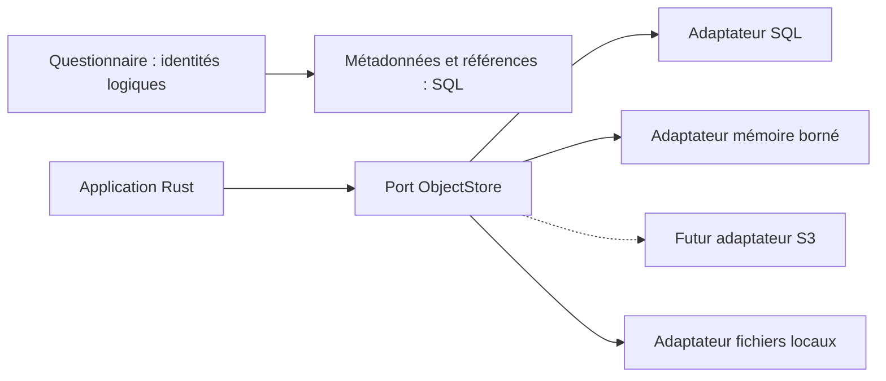

# Décision 0002 — Stockage objet des médias et fichiers

## Statut

Orientation acquise le 11 novembre 2026, premier incrément implémenté le 13
novembre 2026. La demande d’avancer sur la persistance remplace le report
initial des fonctions avec stockage.

Le port `ObjectStore`, ses adaptateurs SQL, mémoire et fichiers locaux ainsi
qu’un parcours d’images natives sont présents. S3 reste à développer. Le mode
local fourni utilise `.data/` ; le mode SQL reste utilisable sans répertoire de
médias. Aucun SDK S3 ni service supplémentaire n’est requis.

## Décision

Le domaine manipule des références logiques de médias. Les contenus binaires
passent par `crates/object-store`, indépendant de HTTP, SQL et du disque.
`WorkspaceState::with_object_store` permet d’injecter un adaptateur.

| Adaptateur          | État       | Rôle                                               |
| ------------------- | ---------- | -------------------------------------------------- |
| `SqlObjectStore`    | Implémenté | Valeur par défaut, même base que les définitions   |
| `MemoryObjectStore` | Implémenté | Tests, limites explicites de volume et d’objets    |
| `S3ObjectStore`     | Prévu      | Endpoint et conteneur compatibles S3 configurables |
| `FileObjectStore`   | Implémenté | Répertoire privé, derrière le même contrat         |

L’adaptateur SQL répond à la contrainte actuelle sans stockage disque attaché
aux médias. Sa table `objects` utilise `LONGBLOB` sur MariaDB, `BYTEA` sur
PostgreSQL et `BLOB` sur SQLite. Le choix reste dans la migration 0003.

Le choix d’un hébergement adapté aux contraintes HDS reste distinct de cette
architecture. Cette décision ne qualifie aucune offre de stockage.

## Contrat implémenté

| Opération | Comportement                                                    |
| --------- | --------------------------------------------------------------- |
| `put`     | Nouvelle clé seulement ; ne remplace jamais un contenu existant |
| `get`     | Objet complet ou plage d’octets, borne supérieure exclusive     |
| `head`    | Taille et empreinte sans charger le contenu                     |
| `delete`  | Idempotent ; les contrôles de rétention appartiennent au métier |

Les clés sont opaques : 64 caractères hexadécimaux minuscules. Un nom de fichier
fourni par le navigateur reste une métadonnée et ne devient jamais une clé ni un
chemin. Une modification de contenu demande une nouvelle identité.

Le port borne chaque contenu à 8 Mio. Le contrat utilise actuellement des
tampons bornés. L’adaptateur fichiers prépare ses écritures dans un répertoire
temporaire privé avant publication atomique. Les adaptateurs SQL et fichiers
lisent le binaire entier avant de découper une plage ; ce n’est pas une lecture
SQL en flux. Un futur adaptateur S3 pourra utiliser les plages du fournisseur.
Le streaming de très gros fichiers devra faire évoluer ce contrat explicitement.

Les erreurs distinguent absence, conflit, indisponibilité, taille, clé et plage
invalides. L’intégrité SHA-256 appartient au contrat ; un ETag fournisseur ne
remplacera pas cette empreinte. SQL et fichiers la vérifient aussi à la lecture.

## Métadonnées et reprise des envois

La table `media` porte étude propriétaire, clé objet, nom, type, taille,
empreinte, état et date. Les clés objet ne sont pas exposées par l’API.
L’énumération vient de SQL, jamais d’un parcours de répertoire ou de conteneur.

Un envoi utilise un UUID stable choisi par le client et un `PUT` authentifié :

1. Créer l’intention SQL `pending` avec les métadonnées contrôlées.
2. Écrire l’objet immuable.
3. Marquer le média `ready`.

Un nouvel essai avec le même identifiant et les mêmes nom, type et empreinte
reconnaît l’objet déjà écrit et termine l’accusé SQL. Un autre contenu produit
HTTP 409. Une panne conserve l’intention ; elle ne rend pas le média public. Les
tests simulent une écriture réussie suivie d’une perte d’accusé.

Les associations sont enregistrées dans `media_references`, dans la même
transaction que la révision. Une image doit être prête et appartenir à l’étude.
Les clés étrangères protègent les références historiques. Le serveur valide les
associations par lots bornés, sans requête par question lors de l’affichage.

Les intentions et images inutilisées sont conservées. Il n’existe pas encore
d’API de suppression ni de collecteur d’orphelins. Un futur nettoyage devra
prendre en compte toutes les révisions et une durée de rétention explicite.

## Premier parcours d’images

L’administrateur envoie des PNG/JPEG, limités à 8 Mio, 8192 pixels par côté et
32 millions de pixels. Le serveur inspecte signature et dimensions déclarées ;
il ne décode pas et ne réencode pas complètement les images. SVG et contenus
actifs ne sont pas admis dans ce parcours.

Les fichiers restent privés tant qu’ils ne sont pas référencés par la révision
courante publique. La lecture privée exige la session administrateur, y compris
pour les anciennes révisions. Le domaine v3 conserve identifiant, description
alternative et éventuelle langue, sans URL fournisseur.

L’API supporte `HEAD`, les plages simples d’octets, les types contrôlés et
`nosniff`. Les lectures de contenu sont bornées à quatre par processus ; le
permis reste dans le corps HTTP jusqu’à consommation ou déconnexion. Les
réponses avancent par blocs de 64 Kio. Les écritures partagent les deux places
de l’administration. Aucun gain de performance n’est revendiqué sans mesure.

Les médias LimeSurvey externes, archives LSA, pièces jointes des participants,
quotas et migrations de ressources ne sont pas couverts. Un export JSON de
définition ne transporte pas les binaires. Une sauvegarde complète doit
conserver SQL et les objets correspondants.

## Vérifications

Le même contrat est exécuté sur mémoire, SQL et fichiers : intégrité binaire
au-delà de 64 Kio, absence, conflit sans écrasement, lecture partielle, limites
et suppression répétée. Les tests API couvrent droits, CSRF, propriété,
exposition publique, restauration historique, reprise après panne et concurrence
bornée. Les migrations et parcours SQL sont vérifiés sur SQLite, PostgreSQL 17
et MariaDB 11.4 dans des environnements jetables.

## Adaptateur local et configuration

Le [guide du stockage local](../local-storage.md) précise `.data/`, la sélection
`OBJECT_STORE_BACKEND=sql|file`, le répertoire `OBJECT_STORE_DIRECTORY`, les
permissions et le protocole de publication. La configuration d’exemple utilise
le mode fichiers ; en l’absence de réglage, le backend conserve SQL.

Le mode fichiers garde un accès en lecture aux anciennes clés SQL. Un objet
local corrompu ou un stockage local indisponible ne déclenche pas cette lecture
de secours. Les nouvelles écritures restent locales. La base actuelle n’est pas
déplacée et les anciens objets SQL ne sont pas supprimés automatiquement. Les
changements de stockage ultérieurs demandent une copie explicite.

Tokio et `tracing`, déjà présents dans le graphe, deviennent des dépendances
directes de la crate objet : I/O bloquante exécutée hors du thread HTTP avec
quatre places, et diagnostic sans contenu privé si un nettoyage échoue. Aucune
nouvelle crate externe n’est ajoutée. Le format local a sa propre signature v1 ;
le schéma SQL et le format natif du questionnaire restent inchangés.
