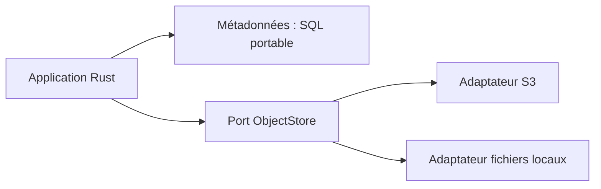

# Décision 0002 — Stockage objet des médias et fichiers

## Statut et priorité

Orientation acquise le 11 novembre 2026. **Implémentation différée** : les
prochains incréments portent sur les formulaires sans persistance métier.
Sauvegarde, reprise, fichiers, ressources durables et autres fonctions avec
stockage restent dans la feuille de route, sans être développés maintenant.

Cette décision fixe la frontière d’architecture pour leur réalisation future.
Aucun adaptateur, SDK S3, service supplémentaire ni migration SQL n’est ajouté.

## Contexte

Le déploiement envisagé sur CleverCloud et la contrainte HDS exprimée pour le
projet motivent un stockage de médias indépendant d’un volume disque attaché au
serveur. Le stockage objet doit être prévu au cœur de l’application.

Le choix d’une offre d’hébergement et la validation de son adéquation au
contexte HDS restent des travaux de déploiement distincts. Cette décision ne
qualifie aucune offre CleverCloud ou S3 sur ce point.

## Décision

L’application accède aux contenus binaires par un port Rust `ObjectStore`. Il
offre un petit contrat de stockage objet, avec deux adaptateurs prévus :

| Adaptateur        | Rôle                                                                              |
| ----------------- | --------------------------------------------------------------------------------- |
| `S3ObjectStore`   | Accès à un service compatible S3, avec endpoint et conteneur configurables        |
| `FileObjectStore` | Même contrat, objets représentés par de simples fichiers dans un répertoire privé |

L’adaptateur disque convient au développement, aux tests et aux installations
qui le choisissent. Il n’impose pas de volume persistant au déploiement S3. Il
implémente directement le port ; aucun serveur HTTP imitant S3 n’est nécessaire.
Le fournisseur S3 et la bibliothèque Rust seront choisis au moment de
l’implémentation, selon ce contrat et les contraintes de dépendances.

Le domaine référence des identités logiques de ressources. Les accès réseau et
disque restent dans les adaptateurs ; aucun parcours métier ne requiert de
chemin de fichier, de répertoire monté ou d’URL propre à un fournisseur.

## Contrat minimal à implémenter

| Opération | Comportement attendu                                                         |
| --------- | ---------------------------------------------------------------------------- |
| `put`     | Écrire un objet à une clé nouvelle depuis un flux borné                      |
| `get`     | Lire le contenu en flux ; prévoir les plages d’octets pour les médias        |
| `head`    | Obtenir existence et métadonnées techniques sans charger le contenu          |
| `delete`  | Supprimer un objet ; répéter une suppression reste sans effet supplémentaire |

Le contrat porte sur des clés opaques et stables générées par RustSurvey. Un nom
importé ou fourni par le navigateur reste une métadonnée ; il ne devient pas un
chemin local. Une mise à jour de contenu crée une nouvelle clé : l’application
ne dépend ni d’un renommage de fichier ni d’un remplacement partiel d’objet.

L’énumération des ressources d’une étude vient du manifeste métier, pas d’un
parcours de répertoire ou d’un listing du conteneur. Les API de copie,
versionnement fournisseur, liens signés et téléversement multipart pourront être
ajoutées selon les besoins ; elles ne sont pas requises par le domaine.

Les erreurs distinguent objet absent, conflit et indisponibilité. Les deux
adaptateurs respectent les mêmes limites de taille, règles de publication et
garanties de réessai. L’empreinte d’intégrité appartient au contrat RustSurvey ;
un éventuel identifiant de cache du fournisseur reste opaque.

## Métadonnées et cycle de vie

SQLite, MariaDB ou PostgreSQL conservent les métadonnées : identité, clé objet,
étude/réponse propriétaire, nom source, type de contenu, taille, empreinte et
état. Le contenu binaire passe par `ObjectStore`. Les migrations correspondantes
viendront avec ces fonctions ; le schéma métier actuel reste vide.

Les références métier conservent la clé logique, plutôt qu’un chemin absolu ou
une URL signée. L’adaptateur peut ainsi changer sans réécrire les réponses. Le
transfert entre stockages copie les contenus, vérifie leurs empreintes et
conserve les correspondances de ressources LimeSurvey.

SQL et le stockage objet ont des cycles d’écriture distincts. Prévoir les états
temporaire → prêt → associé, la reprise d’un envoi et le nettoyage différé des
objets orphelins. Une réponse ne doit référencer un contenu publié qu’après
vérification ; une panne entre téléversement et sauvegarde reste récupérable.

Les contenus sont privés. Le serveur vérifie les droits avant lecture ou
écriture ; les secrets de stockage restent côté serveur. Le service est choisi
explicitement par configuration. Une indisponibilité S3 ne déclenche pas de
bascule automatique vers le disque local.

## Sobriété et vérifications futures

Les imports, lectures et exports utilisent des flux et une concurrence bornée.
Le serveur n’a pas besoin de conserver une copie durable des médias sur son
disque. Un éventuel tampon temporaire sera explicite, borné et nettoyé.

Un même ensemble de tests de contrat devra couvrir l’adaptateur disque et
l’adaptateur S3 : intégrité, objet absent, limites, lecture partielle,
suppression répétée, échec pendant l’écriture et reprise sans écrasement. Les
tests courants utiliseront un répertoire temporaire ou un transport contrôlé ;
les essais réseau seront isolés dans une intégration jetable.

La parité des formulaires continue en attendant ces travaux : types,
expressions, filtres et rendus autonomes. L’aléatoire peut être simulé en
mémoire ; sa reprise durable et les effets de collecte restent différés.
