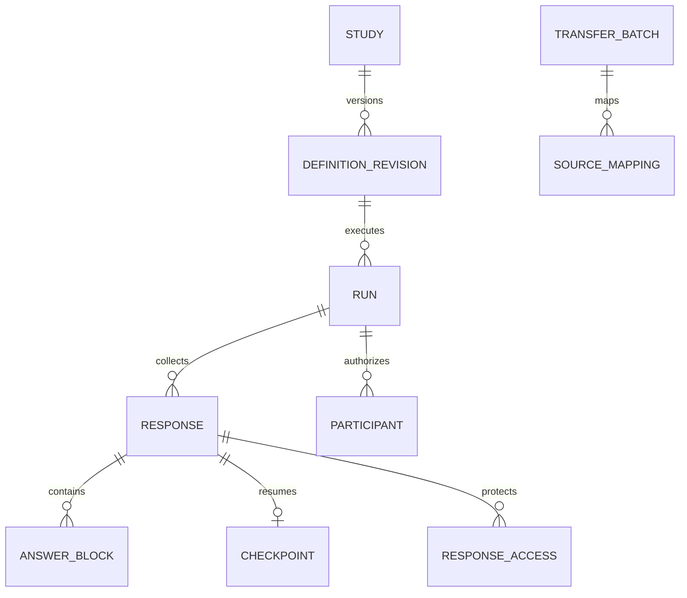

# Modèle interne et stockage des études

## Statut et objectifs

Le modèle général ci-dessous prépare la migration d’études en cours et un
backend sobre sur les trois bases. Le premier sous-ensemble implémenté couvre
`studies`, `definition_revisions` et l’administration, avec migrations SQL. Le
[domaine natif de l’éditeur](authoring.md) porte huit types de questions et un
document versionné indépendant du format LSS. Les autres concepts de ce document
restent des décisions de conception.

Le modèle découle de l’[analyse du code 6.5.14](limesurvey-source-audit.md). Un
export utilisateur enrichira les cas de validation ; il n’est pas un prérequis
pour construire cette architecture.

## Séparation des responsabilités

Le diagramme est conceptuel. Le lien entre participant et réponse dépend de
l’anonymat ; il n’est jamais créé automatiquement pour une étude anonyme.

### Study et DefinitionRevision

`Study` porte l’identité durable de l’étude et sa gestion administrative.
`DefinitionRevision` est un instantané immuable de sa définition :

- langues et textes localisés ;
- groupes, questions, options, sous-questions et échelles ;
- cellules de réponse attendues et leurs coordonnées ;
- valeurs par défaut, contraintes, pertinence, calculs et quotas ;
- paramètres d’exécution effectifs et origine des valeurs héritées ;
- références de ressources et dépendances externes ;
- profil de compatibilité et version du format interne.

Une définition publiée n’est pas modifiée en place. Une édition crée une
nouvelle révision. Un changement concernant des réponses existantes exige une
conversion explicite et un rapport d’impact ; il ne se produit pas au simple
chargement d’un fichier plus récent.

### Run

`Run` est une campagne de collecte liée à une révision de définition. Elle porte
ouverture, fermeture, dates d’accès et politique de participation. Sa vie
opérationnelle est distincte de l’historique des réponses.

La première conception fixe une révision par campagne. Une copie de travail ou
un import reste en préparation ; l’ouverture est une transition explicite
soumise au rapport de compatibilité. Les corrections d’une campagne active
devront définir les conversions autorisées avant d’être implémentées.

### Response, AnswerBlock et Checkpoint

`Response` identifie une participation, sa campagne, sa révision de définition,
son état de soumission et sa version de concurrence. Une réponse importée
partielle reste partielle. Une date de soumission historique n’est pas réécrite
comme un événement de la nouvelle collecte.

L’état soumis est distinct de la connaissance d’un instant réel de soumission.
Une date conventionnelle source reste conservée comme telle ; elle ne devient
pas une mesure réelle inventée lors de l’import.

`AnswerBlock` regroupe les cellules d’un groupe logique stable. Il ne dépend pas
de la pagination d’affichage : un écran peut montrer une question, un groupe ou
plusieurs groupes. Le stockage ne doit pas changer quand la présentation du
questionnaire change.

`Checkpoint` conserve la langue courante, le curseur logique, l’ordre réalisé
des éléments aléatoires et les faits nécessaires à une reprise déterministe. Sa
version d’exécution est explicite. La graine et la dernière page source sont
conservées séparément : elles ne sont pas une preuve suffisante que le curseur
natif a été reconstruit fidèlement.

Le checkpoint et les réponses validées avancent dans la même transaction. Pour
un import, un checkpoint non reconstituable porte un diagnostic qui empêche
d’annoncer la continuité de la participation.

### Participant et ResponseAccess

`Participant` porte les droits d’entrée, jetons, langue, attributs, dates de
validité, usages restants et états d’invitation/soumission importés. Les valeurs
source sont conservées même si l’envoi de courriels n’est pas encore implémenté
; importer ne déclenche aucune invitation ni relance.

`ResponseAccess` donne le droit de reprendre une réponse. Il est distinct du
compte administrateur et de la présence dans la liste des participants. Une
réponse anonyme peut avoir un secret de reprise sans relation avec une identité
de participant.

Un jeton opaque est vérifié via une empreinte adaptée. La valeur d’origine,
nécessaire pour réexporter un jeton importé sans le changer, doit être conservée
dans un stockage de secrets protégé. Une empreinte seule ne permet pas de
satisfaire ce besoin. Le chiffrement utilise une bibliothèque éprouvée et des
clés séparées des données ; sa réalisation vient avec le premier transfert de
secrets.

Les vérificateurs de reprise historiques sont typés par algorithme. Ils ne sont
ni assimilés à un mot de passe en clair, ni convertis en nouvelle empreinte sans
connaître le secret. Un format non pris en charge bloque la continuité annoncée
; une réinitialisation serait un changement explicite.

## Définition des questions et cellules

Une question possède un identifiant interne stable, un code éditorial, un type
discriminé et des réglages typés. Le code n’est pas une clé primaire. Les
identifiants LimeSurvey restent des alias dans l’adaptateur.

Les types sont regroupés en familles de rendu et de données tout en conservant
leur code exact d’origine. Un tableau double échelle garde ses deux échelles ;
un classement garde ses positions ; un commentaire ou un champ « autre » possède
un rôle distinct.

Chaque cellule est adressée par la question, ses éventuels axes, son échelle et
son rôle. Un `FieldBinding` relie cette adresse à la colonne source exacte. Il
est construit à partir de la définition et validé contre les colonnes du fichier
de réponses. Découper seulement une chaîne SGQA par expression régulière ne
suffit pas pour les variantes de questions.

Une cellule distingue absence de colonne, valeur nulle, chaîne vide et valeur
présente lorsque la source les distingue. Les nombres et codes conservent leur
représentation lexicale : pas de passage automatique par un flottant, pas de
suppression de zéros initiaux. Les dates brutes et leur contexte temporel sont
conservés avant toute interprétation UTC.

La fidélité du stockage ne fixe pas arbitrairement l’arithmétique du moteur :
comparaisons, conversions et calculs doivent suivre le profil LimeSurvey retenu
et disposer de cas de référence.

## Règles et exécution

Les textes d’expression source sont conservés avec leurs emplacements. Un
compilateur produit un arbre syntaxique borné et un graphe de dépendances. Le
programme d’exécution est dérivé de la définition, avec sa propre version. Il
peut être reconstruit ; il n’est pas la seule copie des règles source.

Le profil distingue notamment pertinence du groupe/de la question, filtrage des
sous-questions, obligatoire strict ou souple, validation, valeurs par défaut,
équations et quotas. Les anciennes conditions et expressions doivent être
rapprochées selon le comportement amont, sans appliquer deux fois la même règle.

Le client reçoit les règles publiques utiles à ses interactions. Le serveur
réévalue les contrôles nécessaires à chaque sauvegarde et à la soumission. Il
détermine les droits et effets persistants, y compris les valeurs à effacer
lorsqu’une réponse devient non pertinente. Les attributs privés des participants
ne sont pas transmis comme un dictionnaire complet au client.

Les valeurs dépendantes du temps ou de l’aléatoire sont capturées comme faits
d’exécution lorsque nécessaire. Une nouvelle requête ne doit pas rerandomiser
une participation. Reprendre une ancienne graine implique un algorithme et un
ordre d’appels compatibles, ou un ordre réalisé explicitement transmis.

Le même corpus de règles devra vérifier Rust et TypeScript. Le partage de
sémantique est obligatoire ; l’usage de WASM reste une option si ce partage ne
peut pas être assuré simplement avec les deux implémentations.

## Conservation des éléments source

`TransferBatch` décrit un transfert, son origine, son périmètre et son rapport.
Il référence les fichiers reçus, leurs empreintes et une représentation source
qui conserve les sections/champs non interprétés. Les artefacts contenant des
données sensibles sont protégés et ne sont pas servis par le web.

`SourceMapping` relie des identifiants internes à une identité source composée
de l’installation, de l’étude, du type d’objet et de son identifiant externe.
Deux installations ayant le même `sid` ne désignent pas la même étude.

Les alias d’export sont stables pour une révision. Les nouveaux objets reçoivent
des alias libres ; toutes les références et colonnes de réponses utilisent la
même correspondance. Les éléments inconnus qui peuvent contenir des références
empêchent un réexport transformé si leur cohérence n’est pas démontrable.

Une donnée conservée mais non interprétée peut être archivée et réexportée dans
un périmètre prouvé. Elle ne rend pas l’étude exécutable. Le rapport sépare
toujours conservation, export et exécution.

## Stockage retenu

Le premier modèle utilise des tables communes aux études et un stockage hybride.
Les colonnes relationnelles portent identités, relations, états, dates utiles,
compteurs et versions. Des documents JSON versionnés, stockés en texte, portent
les définitions et blocs de réponses typés.

Cette représentation est décodée et validée par Rust. Aucune requête métier ne
dépend d’un opérateur JSON spécifique au moteur SQL.

Les contenus binaires des médias et pièces jointes utiliseront le port
`ObjectStore` défini dans la [décision 0002](decisions/0002-object-storage.md),
avec adaptateurs S3 et fichiers locaux. La base conserve les identités,
relations, clés objet et métadonnées ; le domaine manipule des références
logiques indépendantes de l’endpoint ou du chemin local. Ces fonctions avec
stockage restent différées pour les prochains incréments.

| Option            | Atout             | Coût                |
| ----------------- | ----------------- | ------------------- |
| Table par étude   | Colonnes directes | DDL par activation  |
| Ligne par cellule | Requêtes fines    | Écritures multiples |
| Tables et blocs   | Schéma fixe       | Validation Rust     |

La troisième option est retenue pour commencer. Les définitions immuables
peuvent être chargées depuis un cache borné partagé entre requêtes. Une
sauvegarde ne réécrit que les blocs affectés et le checkpoint. L’export lit les
réponses par lots ; il ne charge pas une étude entière en mémoire.

Les tables `studies` et `definition_revisions` sont présentes. Les suivantes
restent à réaliser : `runs`, `responses`, `answer_blocks`, `response_access`,
`participants`, `transfer_batches`, `operation_receipts` et les correspondances
source. Checkpoint et métadonnées peuvent rester sur la ligne réponse ; une
table par concept n’est pas imposée.

Les identifiants d’objets internes sont des UUID sous forme textuelle canonique.
Les versions et compteurs utilisent des entiers ; les instants natifs utilisent
une représentation UTC explicite et commune aux trois moteurs. Ces choix ne
remplacent pas la conservation des représentations temporelles source ambiguës.

Les index initiaux concernent campagne/état de réponse, correspondances externes
et recherche des droits d’accès. Les index de valeurs pour les statistiques
seront des projections reconstruisibles, ajoutées selon les besoins mesurés. Ne
pas introduire d’emblée un historique événementiel complet.

## Écriture, concurrence et ressources

Une commande de sauvegarde porte la révision attendue de la réponse et un
identifiant d’opération. Une mise à jour conditionnelle de la version remplace
la dépendance à un verrou SQL propre à un moteur.

Après validation sur l’état lu, une transaction vérifie cette version,
enregistre les blocs et le checkpoint, traite les compteurs concernés et
enregistre le résultat de l’opération. Un conflit annule toute l’écriture. Les
répétitions de la même opération n’enregistrent pas une seconde réponse et ne
consomment pas deux fois un usage ou une place de quota.

Réutiliser un identifiant d’opération avec un autre contenu produit un conflit.
Les reçus sont propres à la réponse et vérifiés après autorisation ; ils ne
permettent pas de lire le résultat d’une autre participation.

La durée de conservation des reçus d’opération et la fenêtre de répétition
acceptée sont explicites et bornées. Les compteurs se réconcilient avec les
réponses importées ; ils ne sont pas recalculés en balayant toutes les réponses
à chaque interaction.

Les limites de taille de définition, de bloc et de commande ainsi que le budget
d’évaluation seront configurables et testées. Le traitement est borné par
l’étude manipulée et le graphe affecté, pas par le nombre global de sessions
ouvertes.

## Versions indépendantes

Ne pas confondre révision d’une définition, version de son document JSON,
version du programme/checkpoint d’exécution, migrations SQL de RustSurvey et
`DBVersion` du fichier LimeSurvey. Une évolution de l’un de ces formats
n’autorise pas une conversion silencieuse des autres.
